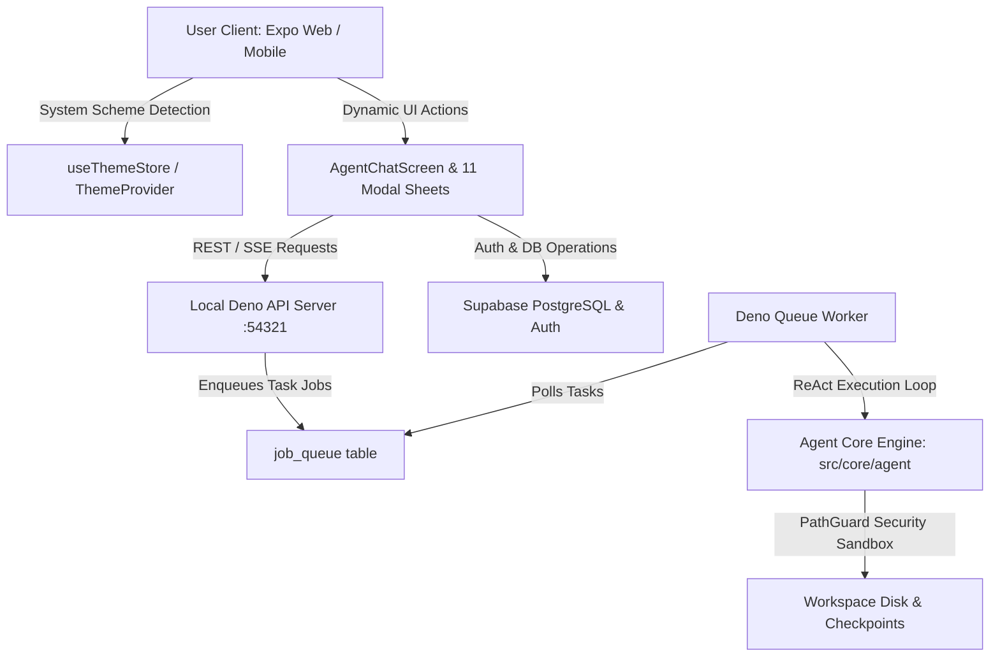

# Issac / Retro Code Pro - Complete Technical Handover & Architecture Guide

This document provides a comprehensive technical overview of **Retro Code Pro** (formerly Issac AI), an autonomous multi-step AI Agent Coding & Builder platform built with React Native (Expo Web), Deno API Gateway, and Supabase PostgreSQL.

---

## 🚀 System Architecture Overview



---

## 🎨 UI Design System & Theme Specs

### 1. Automatic System Color Scheme Detection
*   **Default Theme:** Automatically detects OS preference via React Native `Appearance.getColorScheme()`.
*   **Three themes:** `light`, `dark`, `darkest`.
*   **The palette lives in [`src/theme/theme.ts`](src/theme/theme.ts) and that file is the only source of truth.**

> ⚠️ **Corrected 17 Aug 2026.** This section used to list every colour by hex — a
> deep purple `#6D42C7` brand on pure white. All of it was out of date: the
> palette was replaced with a Perplexity-derived one (near-black `#0E0F0F`
> canvas, turquoise `#3FC1D3` accent, `#F3F3EE` ink). Rather than restate values
> that will drift again the moment the theme changes, read `ColorTokens` in
> `src/theme/theme.ts`. Nothing in the app hardcodes a colour; every component
> reads tokens through `useTheme()`.
>
> The launch assets in `assets/` follow the same palette — regenerate them with
> `python scripts/recolour-assets.py` if it changes again, and keep
> `app.json`'s `splash.backgroundColor` equal to `canvasBase` in the darkest
> theme, or launching flashes one colour and then another.

### 2. Header Bar & Floating Controls (`AgentChatScreen.tsx`)
*   **Top Header Bar:** Profile avatar button (left), Chat/Build mode switcher (center), Incognito ghost button (right) styled with `#FFFFFF` background, `#E2E8F0` border, and elevated `zIndex: 50` for unblocked touch interactions.
*   **Center Watermark:** `retro code pro` title and subtitle aligned in the true vertical center of the upper viewport.
*   **Half-Screen Models Sheet (`showModelsModal`):** Compact ~52% viewport height bottom sheet with zero top whitespace, featuring Gemini 3.1 Pro, Sonnet 3.5, Opus 5, GPT-5.6, Grok 4.5, and Thinking Mode toggle switch.

---

## 🗄️ Backend Core Engine Architecture (`src/core/agent`)

The backend contains a 3-phase autonomous agent execution engine with 49 Vitest unit tests:

1.  **Phase 1 - Foundation:**
    *   ReAct reasoning loop (`loop.ts`)
    *   Tool Registry (`toolRegistry.ts`) with 15+ tools (`write_to_file`, `multi_replace_file_content`, `run_command`, `grep_search`, `read_file`, `list_dir`).
2.  **Phase 2 - Security & Sandbox:**
    *   `pathGuard.ts` to prevent directory traversal outside sandbox root.
    *   VCS-free Git snapshot checkpoints & rollback engine (`checkpoint.ts`).
    *   Permission rules engine (`permissions/policyEngine.ts`).
3.  **Phase 3 - Advanced Execution:**
    *   **Plan Mode (`plan/`):** Generates `implementation_plan.md` & `walkthrough.md` before tool runs.
    *   **Goal Loop Verifier (`planVerifier.ts`):** Runs automated test/build commands and self-heals errors until passing.
    *   **Bounded Parallel Subagents (`subagent/`):** Splits heavy tasks across up to 3 parallel subagents in isolated overlays with safe merge conflict resolution.
    *   **MCP Protocol Client (`mcp/`):** Connects external approved tool servers.

---

## 🔑 Environment Secrets & Config (`.env`)

```ini
# Supabase Project Credentials
SUPABASE_URL=https://qnrsiukutehcqjhmpuze.supabase.co
SUPABASE_ANON_KEY=eyJhbGciOiJIUzI1NiIsInR5cCI6IkpXVCJ9...
SUPABASE_SERVICE_ROLE_KEY=eyJhbGciOiJIUzI1NiIsInR5cCI6IkpXVCJ9...

# Worker Verification Secret (never commit the real value — set it only in .env / Supabase Secrets)
QUEUE_WORKER_SECRET_V2=<generate-a-new-random-secret>

# LLM Provider Keys
ANTHROPIC_API_KEY=sk-ant-api03-...
OPENAI_API_KEY=sk-nry-...
```

---

## ⚡ Deployment & Running Commands

### 1. Boot Expo Web Frontend:
```bash
cd frontend
npx expo start --web --clear
```

### 2. Boot Local Deno API Gateway & Worker:
```bash
npx deno run --allow-all local-api-server.ts
npx deno run --allow-all run-local-worker.ts
```

### 3. Expose Live Public Tunnel (TryCloudflare):
```bash
npx cloudflared tunnel --url http://localhost:8081
```

*Live TryCloudflare Endpoint:* `https://switching-invisible-folk-texts.trycloudflare.com`
